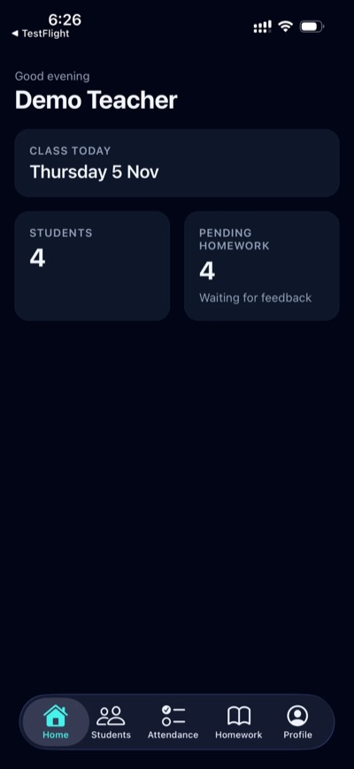
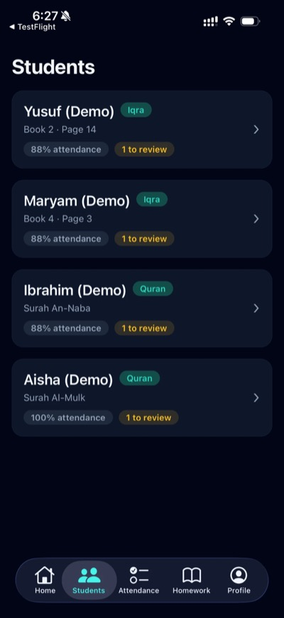
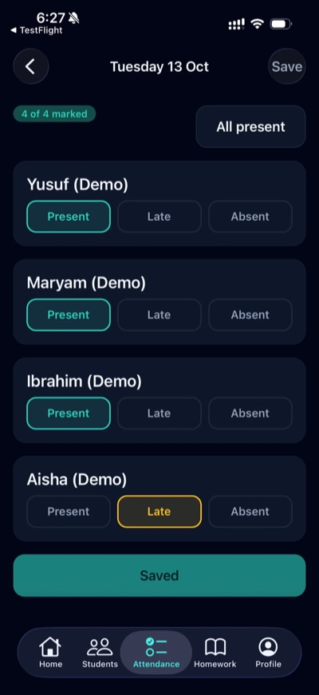
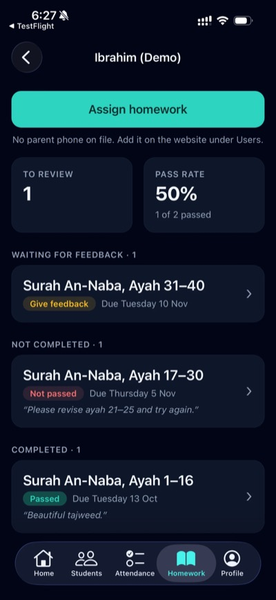
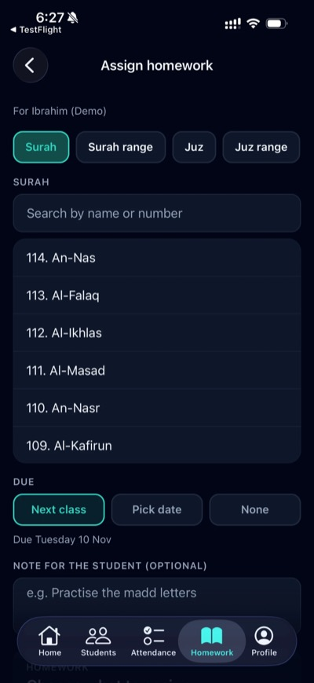

# MAS Quran Madrasah

A school management platform for a Quran school in Australia, with a website for administrators and a mobile app for teachers and students. Teachers use it to take attendance, set and review homework, track each student's progress, and keep parents informed on WhatsApp.

**[Download on the App Store](https://apps.apple.com/au/app/id6831026841)**

<p>
  
  
  
  
  
</p>

Screenshots use made-up demo data.

## Features

- **Three roles:** administrators, teachers and students each get their own experience, enforced in the database with row-level security.
- **Attendance:** mark each class as present, late, absent or excused, with a per-student history.
- **Homework:** assign Iqra pages or Quran surahs, juz and ayah ranges, then record a pass or fail with feedback.
- **Progress:** follow each student through the Iqra books and the Quran.
- **Parent updates:** teachers send a pre-filled WhatsApp message with upcoming homework in one tap.
- **Administration:** manage users, class terms, term payments, a shared library and school-wide analytics on the website.

## Tech stack

| Area | Tools |
| --- | --- |
| Website | Next.js 16 (App Router), React, TypeScript, Tailwind CSS |
| Mobile app | Expo, React Native, Expo Router, TanStack Query |
| Backend | Supabase (Postgres, Auth, row-level security) |
| Hosting and delivery | Vercel, EAS Build and EAS Update |
| Testing | Playwright |

## Project structure

```
src/                 Next.js website, with route groups for each role
mobile/              Expo app for iOS and Android
supabase/migrations/ Database schema, security policies and functions
tests/e2e/           Playwright end-to-end tests
```

## Running it locally

You'll need Node.js 22 or later and a Supabase project.

1. Run the SQL files in `supabase/migrations` in order. The numbering has gaps because data-only migrations aren't included.
2. Copy `.env.example` to `.env.local` and add your Supabase keys.
3. Create the first admin and start the website:

   ```bash
   npm install
   npx tsx --env-file=.env.local scripts/seed.ts
   npm run dev
   ```

4. Start the mobile app from `mobile/`, after adding your Supabase URL and anon key as `EXPO_PUBLIC_SUPABASE_URL` and `EXPO_PUBLIC_SUPABASE_ANON_KEY` in `mobile/.env.local`:

   ```bash
   npm install
   npx expo start
   ```

The end-to-end tests read their logins from `TEST_*` environment variables.

## About this repository

This is a public copy of the code. Student, parent and staff information, and the migrations that held it, aren't included.
